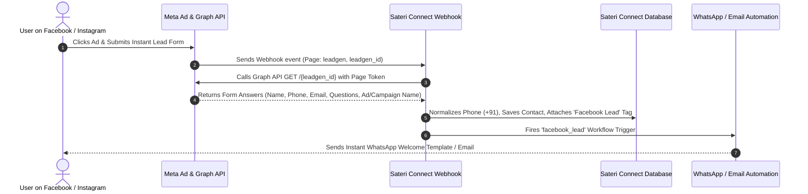

# Sateri Connect — Meta Facebook Lead Ads Complete Setup Guide

A complete step-by-step technical and operational manual for connecting **Meta (Facebook/Instagram) Lead Ads** to **Sateri Connect** to automatically ingest leads, save contacts, and fire instant automated WhatsApp/Email workflows.

---

## Table of Contents
1. [Architecture & How It Works](#1-architecture--how-it-works)
2. [Prerequisites](#2-prerequisites)
3. [Step 1: Meta Developer App Settings](#3-step-1-meta-developer-app-settings)
4. [Step 2: Webhook Subscription (`Page` &rarr; `leadgen`)](#4-step-2-webhook-subscription-page--leadgen)
5. [Step 3: Meta App Review & Required Permissions](#5-step-3-meta-app-review--required-permissions)
6. [Step 4: Meta Business Suite & Leads Access Manager](#6-step-4-meta-business-suite--leads-access-manager)
7. [Step 5: Connect Page & Token in Sateri Connect](#7-step-5-connect-page--token-in-sateri-connect)
8. [Step 6: Setting up the Automated Workflow](#8-step-6-setting-up-the-automated-workflow)
9. [Step 7: Testing Free with Meta Lead Ads Testing Tool](#9-step-7-testing-free-with-meta-lead-ads-testing-tool)
10. [Troubleshooting & Gotchas](#10-troubleshooting--gotchas)

---

## 1. Architecture & How It Works

1. **User Action:** Customer clicks your ad on Facebook or Instagram and fills the Meta Instant Form.
2. **Instant Notification:** Meta sends a secure webhook payload to Sateri Connect (`POST /webhooks`) containing the `leadgen_id` and `page_id`.
3. **Data Fetching:** Sateri Connect queries Meta's Graph API (`/{leadgen_id}`) using the Page Access Token to retrieve form answers.
4. **Data Protection & Storage:**
   - Phone is normalized to E.164 (automatically adds `+91` for 10-digit Indian numbers).
   - Contact is upserted (duplicates prevented; existing contacts are updated).
   - Tagged automatically with `#1877F2` **"Facebook Lead"** customer group.
   - Ad Name and Campaign Name are saved in contact custom attributes (`fb_ad_name`, `fb_campaign_name`).
5. **Workflow Execution:** Automation engine runs any workflow configured with the **Facebook Lead** trigger.

---

## 2. Prerequisites

Before configuring, have the following ready:
* A **Meta Developer Account** ([https://developers.facebook.com](https://developers.facebook.com)).
* A **Meta Business Portfolio (Business Manager)** with admin access ([https://business.facebook.com](https://business.facebook.com)).
* A **Facebook Page** where the lead ads will run.
* A live public HTTPS domain or an active tunnel (e.g. ngrok / Cloudflare Tunnel) pointing to your Sateri Connect installation. (Meta cannot send webhooks to `localhost`).

---

## 3. Step 1: Meta Developer App Settings

1. Navigate to the **Meta Apps Dashboard**:
   * **URL:** [https://developers.facebook.com/apps/](https://developers.facebook.com/apps/)
2. Select your existing app (or click **Create App** &rarr; select **Business** type).
3. In the left navigation, go to **App Settings &rarr; Basic**:
   * Copy the **App ID**.
   * Click **Show** and copy the **App Secret**.
   * Ensure **Privacy Policy URL** and **Terms of Service URL** are filled (Required for live mode).
   * In **App Domains**, add your domain (e.g. `yourdomain.com`).

---

## 4. Step 2: Webhook Subscription (`Page` &rarr; `leadgen`)

1. In the left sidebar of your Meta App, go to **Webhooks**:
   * *(If Webhooks is not listed, click **Add Product** in the sidebar, find **Webhooks**, and click **Set up**).*
2. In the dropdown at the top of the Webhooks page, select **Page** (Do NOT choose WhatsApp Business Account or User).
3. Click **Subscribe to this object** (or **Edit Subscription**):
   * **Callback URL:** `https://your-domain.com/webhooks`
   * **Verify Token:** The verify token configured in Sateri Connect (Default: `sateri_meta_verify_2026` or check `Settings -> Meta`).
   * Click **Verify and save**.
4. In the list of Page Webhook fields:
   * Locate the row named **`leadgen`**.
   * Click **Subscribe** (A green badge will indicate active subscription).

---

## 5. Step 3: Meta App Review & Required Permissions

Meta enforces granular permissions for accessing lead data.

* **URL:** `https://developers.facebook.com/apps/{YOUR_APP_ID}/app-review/permissions/`

### Permissions Required:
| Permission | Purpose | Dev Mode | Live Mode |
|---|---|---|---|
| `leads_retrieval` | Allows Sateri Connect to pull form answers via Graph API | Works for App Admins/Testers | **Requires App Review** (Advanced Access) |
| `pages_show_list` | Allows listing and picking your Facebook Pages | Works for App Admins | Advanced Access |
| `pages_read_engagement` | Allows reading Page-level events | Works for App Admins | Advanced Access |
| `pages_manage_ads` | Links ad campaigns to lead forms | Works for App Admins | Advanced Access |
| `pages_manage_metadata` | Subscribes webhooks directly to the Page | Works for App Admins | Advanced Access |

> [!IMPORTANT]
> While the Meta App is in **Development Mode**, real public users filling ads will **NOT** trigger webhooks. You must submit `leads_retrieval` for App Review to switch your app to **Live Mode**.

---

## 6. Step 4: Meta Business Suite & Leads Access Manager

A frequent point of failure is Meta's CRM access control. Even if the app is connected, Meta will block webhook delivery if CRM access is restricted.

1. Open **Meta Business Settings**:
   * **URL:** [https://business.facebook.com/settings/lead-access](https://business.facebook.com/settings/lead-access)
2. In the left sidebar, click **Integrations &rarr; Leads Access**.
3. Select your **Facebook Page**.
4. Click on the **CRMs** tab:
   * If it says **"Default Access"**, keep it active.
   * If you have customized CRM access, click **Assign CRMs**, select your **Meta App**, and confirm.

---

## 7. Step 5: Connect Page & Token in Sateri Connect

You need to provide Sateri Connect with a Page Access Token so it can query `/{leadgen_id}`.

### Option A: Via Sateri Connect Settings (Permanent Page Token)
1. Generate a Never-Expiring Page Access Token via [Meta Graph API Explorer](https://developers.facebook.com/tools/explorer/) or System User.
2. Log into Sateri Connect and navigate to **Settings &rarr; Meta Configuration** (`/settings`).
3. Fill in:
   * **Facebook Page ID:** Your Facebook Page ID (e.g. `102938475610293`).
   * **Page Access Token:** The generated Page Token.
4. Click **Save Settings**. Sateri Connect will automatically execute `subscribed_apps` to ensure your Page is linked to `leadgen`.

### Option B: Via Workflow Builder (Interactive Login Wizard)
1. Go to **Automations &rarr; Workflows &rarr; Builder** (`/automations/{id}/builder`).
2. Drag and drop the **Facebook Lead** trigger node.
3. In the Inspector panel, click **Login with Facebook**.
4. Select your **Portfolio &rarr; Ad Account &rarr; Page &rarr; Form**.
5. Click **Save**.

---

## 8. Step 6: Setting up the Automated Workflow

1. In Sateri Connect, go to **Workflows &rarr; Create Workflow** (`/automations/create`).
2. Name your workflow: e.g. `Facebook Lead Instant Response`.
3. Open the **Builder**:
   * Set the Trigger to **Facebook Lead**.
   * *(Optional)* Filter by specific **Form ID** or leave blank for all forms on the Page.
4. Add an **Action** node:
   * **Send WA template:** Select your pre-approved WhatsApp welcome template.
   * Or **Send Text:** Write your reply using dynamic variables:
     * `Hello {{contact.name}}! Thank you for your inquiry on our {{ad_name}} campaign.`
5. *(Optional)* Add an **If / Else** condition:
   * Condition: `is_existing == 1`
   * **True Branch:** Send "Welcome back to our VIP customer service!"
   * **False Branch:** Send "Welcome to our brand! Here is our catalog."
6. Toggle workflow to **Active** and click **Save**.

---

## 9. Step 7: Testing Free with Meta Lead Ads Testing Tool

You do NOT need to spend money on live ads to verify your setup. Meta provides a dedicated simulator.

* **URL:** [https://developers.facebook.com/tools/lead-ads-testing](https://developers.facebook.com/tools/lead-ads-testing)

### Step-by-Step Test:
1. Open the tool link above.
2. Select your **Page** and **Form**.
3. *(Optional)* Click **Preview form** to enter test details (e.g. Name: `Test Lead`, Phone: `9822012345`, Email: `test@example.com`).
4. Click **Create lead**.
5. Click **Track status**:
   * You should see:
     * `Webhook status: Success`
     * `HTTP response code: 200`
6. Switch to Sateri Connect:
   * Check **Contacts** (`/contacts`) &rarr; Your test contact is present with the **"Facebook Lead"** tag.
   * Check **Activity Logs** (`/activity-logs`) &rarr; An audit entry confirms the workflow executed.

---

## 10. Troubleshooting & Gotchas

| Issue | Cause | Solution |
|---|---|---|
| **Webhook returns 403 Forbidden** | Webhook Verify Token mismatch or invalid signature. | Check `Settings -> Meta` in Sateri Connect. Ensure the verify token in Meta Developer Portal matches Sateri Connect. |
| **"Track status" shows 100 / Unknown error** | Meta cannot reach your webhook URL. | Verify your domain has a valid SSL certificate (HTTPS) and port 443 is open. Localhost requires an active ngrok/tunnel. |
| **Lead created but contact has no phone** | Form omitted phone or entered < 8 digits. | Sateri Connect now supports email-only leads. Check email in contacts list. |
| **WhatsApp message fails to deliver** | Number missing country code. | Sateri Connect automatically normalizes 10-digit Indian numbers with `+91`. For other regions, ensure the form enforces country code. |
| **Test leads work, but real ad leads don't appear** | Meta App is in Development mode or CRM access restricted. | 1. Check Leads Access Manager in Meta Business Suite. 2. Submit `leads_retrieval` for App Review to enable Live Mode. |
| **"Facebook lead id is not valid" in logs** | Page Access Token expired. | Generate a long-lived or System User token in Meta Business Manager and update in Sateri Connect Settings. |
