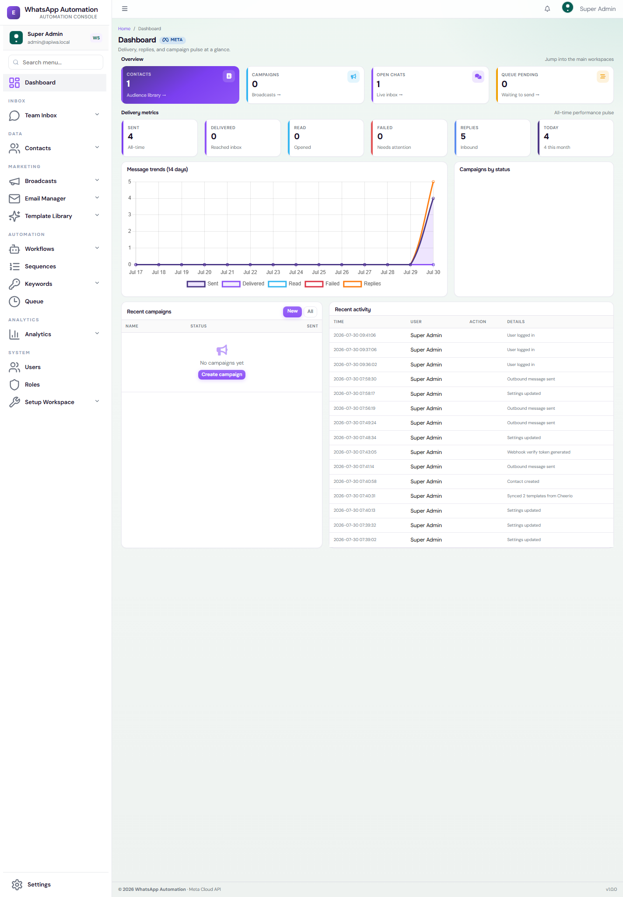
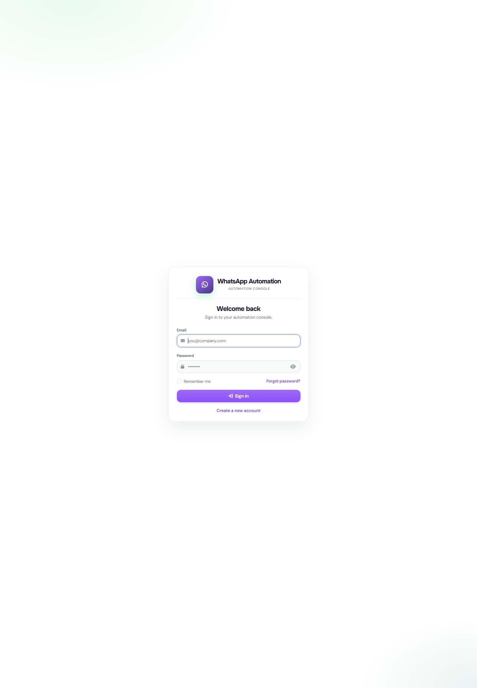
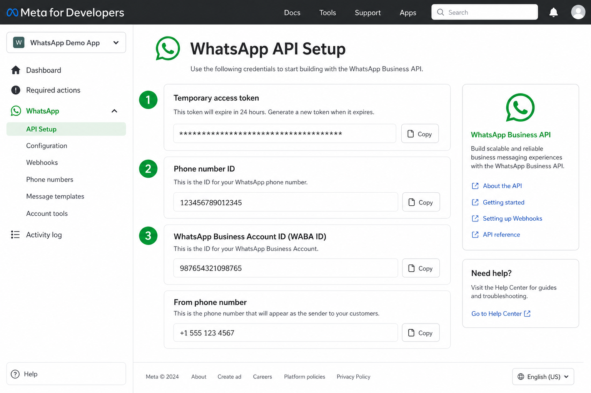
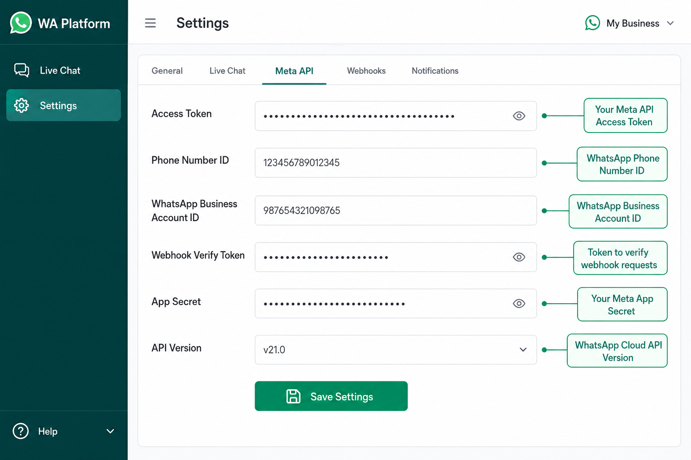
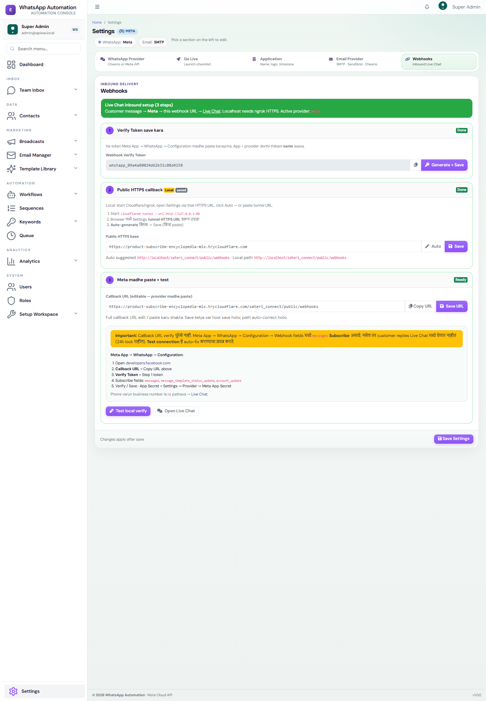
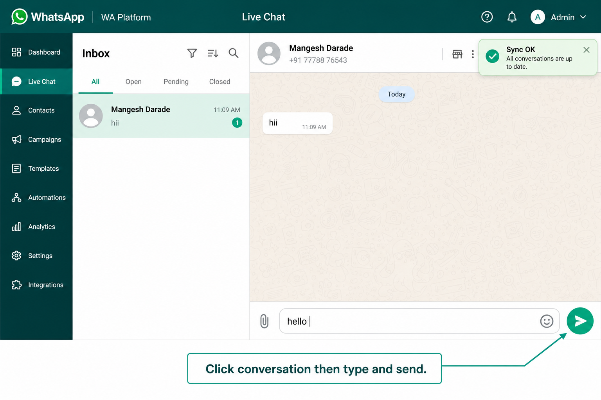
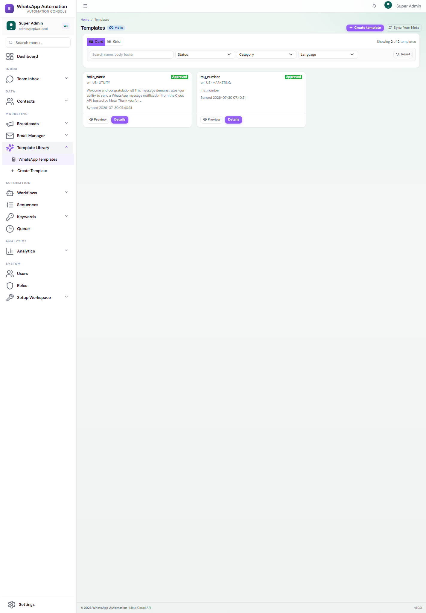
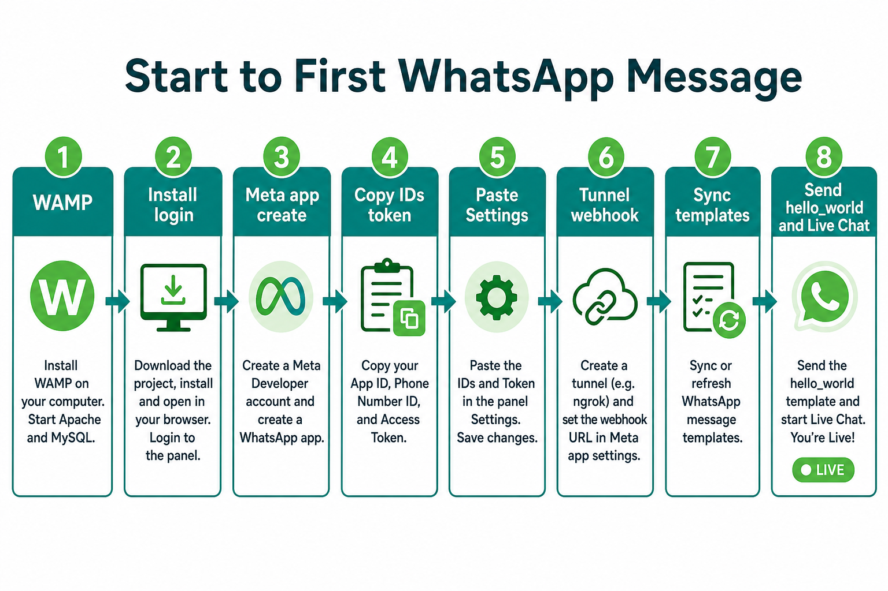

# Meta Official Screenshot Walkthrough

This is a screenshot-first companion to:

- [META_OFFICIAL_DEVELOPER_TO_PUBLISH_GUIDE.md](META_OFFICIAL_DEVELOPER_TO_PUBLISH_GUIDE.md)

Use this when you want the shortest practical path with visual checkpoints.

---

## 1. Local App Access Ready

Before Meta setup, confirm the app is reachable in browser.

What to confirm:

- local site opens
- `public/` path is correct
- you can reach Chat. Settings is in the profile menu, not the left sidebar

---

## 2. Login to Sateri Connect

You should be able to enter the admin panel before testing Meta credentials.

Why this matters:

- App Review videos should show your actual product UI
- later steps need Settings, Templates, and Live Chat screens

---

## 3. Platform Connect WhatsApp

Connect WhatsApp is only on the platform admin page **Embedded Signup**. The client workspace does not show this button, and **Settings** is not in the client sidebar.

On **Platform → Embedded Signup**:

1. Save the shared Tech Provider App ID, Embedded Signup Config ID, and App Secret.
2. Run **Test Meta API**. A green result means Meta recognized the app. It does not connect a phone number.
3. In **Connect a client**, press **Connect WhatsApp** on that client's row.
4. The Meta popup must open from an **https://** page (or it shows "isn't using a secure connection").
5. After the popup, the token, WABA ID, and Phone Number ID are saved on that client.

---

## 4. Client Meta fields

The client can still paste a token by hand. Open **Settings** from the profile menu, not the left sidebar. Email transport is **Email Manager → Email Settings**.

Manual Meta fields:

- Provider = `Meta`
- Meta Access Token
- Phone Number ID
- WABA ID
- API Version
- Webhook Verify Token

Then run **Test connection**. Do not look for **Connect WhatsApp** on this screen.

Expected result:

- credentials accepted
- no configuration error from Meta API

---

## 5. Webhooks Setup Screen

This is the current Webhooks tab in Sateri Connect.

Use this area for:

- Meta callback URL
- webhook verification
- inbound reply testing

Recommended callback:

`https://your-public-domain/webhooks`

If local:

- use Cloudflare Tunnel or ngrok
- point the public URL to your local app

---

## 6. Verify Webhook and Test Inbound Messages

After Meta webhook configuration, validate inbound flow inside chat.

What to test:

1. customer sends WhatsApp message to connected number
2. webhook receives event
3. conversation appears in Live Chat
4. reply from agent works

If this step fails, usually the issue is:

- callback URL not public
- verify token mismatch
- `messages` field not subscribed

---

## 7. Sync Approved Templates

Once templates are created/approved on Meta side, sync them into the app.

Why this matters:

- first outbound messages usually require templates
- App Review proof for `whatsapp_business_management` is stronger if template sync/manage flow is visible

Validate:

- template list loads
- approved templates are visible
- template send works from chat/campaign flow

---

## 8. Go Live Checklist Screen

Use this as the final current app-side launch checklist screen.

Recommended order:

1. Meta developer account
2. business portfolio
3. app creation
4. WhatsApp API setup
5. first test message
6. business verification
7. API permission test calls
8. webhook verification
9. template sync
10. App Review evidence
11. Advanced Access
12. permanent token
13. Live mode
14. final production testing

---

## 9. App Review Video Checklist

If you are submitting for Advanced Access, record these flows from your UI:

### Video A: `whatsapp_business_messaging`

- login
- open chat or campaign screen
- send WhatsApp message
- show message delivered on recipient side

### Video B: `whatsapp_business_management`

- open templates area
- sync/list/manage templates
- show linked WABA behavior in app

### Video C: `business_management`

- show business asset or onboarding/business connection flow

Do not submit videos that only show Graph API Explorer.

---

## 10. Final Go-Live Checklist

- [ ] app basic settings complete
- [ ] privacy policy URL live
- [ ] business verification complete
- [ ] required Graph API calls completed
- [ ] App Review approved if platform/multi-business
- [ ] permanent System User token created
- [ ] webhook verified
- [ ] templates approved and synced
- [ ] outbound send tested
- [ ] inbound chat tested
- [ ] app switched to Live

---

## 11. Related Docs

- [META_OFFICIAL_DEVELOPER_TO_PUBLISH_GUIDE.md](META_OFFICIAL_DEVELOPER_TO_PUBLISH_GUIDE.md)
- [META_APP_REVIEW_API_TESTING.md](META_APP_REVIEW_API_TESTING.md)
- [META_PUBLISH_GO_LIVE.md](META_PUBLISH_GO_LIVE.md)
